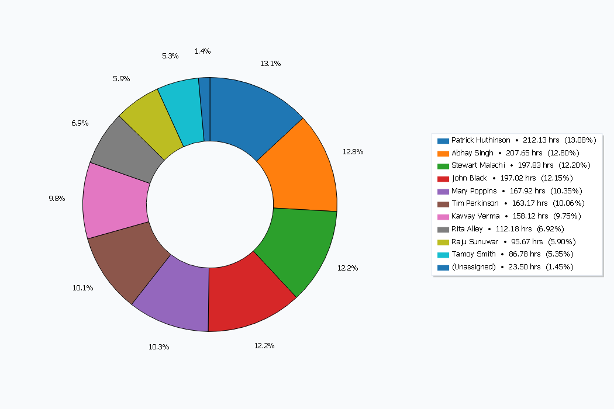

# Rapid Technologies Assessment - Employee Time Visualizer (C#)

A C# console application that fetches employee time entries from an Azure REST endpoint, aggregates total working hours per employee, and produces:

1. **HTML Report (`employees.html`)**: Styled HTML report containing an employee table sorted by total hours worked, with employees below 100 hours highlighted.
2. **Pie Chart (`piechart.png`)**: Pie chart showing each employee's percentage share of total hours worked.

---

## Downloads

Standalone executables and generated outputs are available under [GitHub Release v1.0.0](https://github.com/dumm5141-ui/rapidd-assessment/releases/tag/v1.0.0):

- **Windows x64 Executable**: [`Rituraj_C# Assignment.exe`](https://github.com/dumm5141-ui/rapidd-assessment/releases/download/v1.0.0/Rituraj_C%23%20Assignment.exe) (GitHub asset: [Rituraj_C.Assignment.exe](https://github.com/dumm5141-ui/rapidd-assessment/releases/download/v1.0.0/Rituraj_C.Assignment.exe))
- **Linux x64 Executable**: [`Rituraj_C# Assignment`](https://github.com/dumm5141-ui/rapidd-assessment/releases/download/v1.0.0/Rituraj_C%23%20Assignment) (GitHub asset: [Rituraj_C.Assignment](https://github.com/dumm5141-ui/rapidd-assessment/releases/download/v1.0.0/Rituraj_C.Assignment))
- **HTML Report**: [`employees.html`](https://github.com/dumm5141-ui/rapidd-assessment/releases/download/v1.0.0/employees.html)
- **Pie Chart Image**: [`piechart.png`](https://github.com/dumm5141-ui/rapidd-assessment/releases/download/v1.0.0/piechart.png)

---

## Output Preview

### Pie Chart (`piechart.png`)



### Summary Table

| Rank | Employee Name | Total Hours | Share (%) | Status |
|:---:|:---|:---:|:---:|:---:|
| 1 | Patrick Huthinson | 212.13 hrs | 13.08% | Normal |
| 2 | Abhay Singh | 207.65 hrs | 12.80% | Normal |
| 3 | Stewart Malachi | 197.83 hrs | 12.20% | Normal |
| 4 | John Black | 197.02 hrs | 12.15% | Normal |
| 5 | Mary Poppins | 167.92 hrs | 10.35% | Normal |
| 6 | Tim Perkinson | 163.17 hrs | 10.06% | Normal |
| 7 | Kavvay Verma | 158.12 hrs | 9.75% | Normal |
| 8 | Rita Alley | 112.18 hrs | 6.92% | Normal |
| 9 | Raju Sunuwar | 95.67 hrs | 5.90% | < 100 hrs |
| 10 | Tamoy Smith | 86.78 hrs | 5.35% | < 100 hrs |
| 11 | (Unassigned) | 23.50 hrs | 1.45% | < 100 hrs |

---

## Project Structure

```
rapidd-assessment/
├── .github/workflows/ci.yml       # GitHub Actions CI for Linux and Windows validation
├── src/EmployeeTimeVisualizer/
│   ├── Models/
│   │   ├── TimeEntry.cs           # DTO mapping raw API JSON schema
│   │   └── EmployeeSummary.cs     # Aggregated employee statistics model
│   ├── Services/
│   │   ├── TimeEntryApiService.cs # Fetches time entry JSON from Azure endpoint
│   │   ├── EmployeeReportService.cs # Aggregates hours, handles unassigned, sorts descending
│   │   ├── HtmlReportGenerator.cs # Generates employees.html with threshold highlights
│   │   └── PieChartGenerator.cs   # Renders piechart.png using ScottPlot 5
│   ├── Program.cs                 # Main entry point orchestrating data flow
│   └── EmployeeTimeVisualizer.csproj
├── employees.html                 # Generated HTML report
├── piechart.png                   # Generated pie chart PNG image
└── EmployeeTimeVisualizer.sln     # Solution file
```

---

## Build and Run

### 1. Run the Application

```bash
dotnet run --project src/EmployeeTimeVisualizer/EmployeeTimeVisualizer.csproj
```

### 2. Publish Standalone Single-File Executables

**Windows (x64):**
```bash
dotnet publish src/EmployeeTimeVisualizer/EmployeeTimeVisualizer.csproj \
  -c Release \
  -r win-x64 \
  --self-contained true \
  -p:PublishSingleFile=true \
  -p:IncludeNativeLibrariesForSelfExtract=true \
  -o publish/win
```

**Linux (x64):**
```bash
dotnet publish src/EmployeeTimeVisualizer/EmployeeTimeVisualizer.csproj \
  -c Release \
  -r linux-x64 \
  --self-contained true \
  -p:PublishSingleFile=true \
  -p:IncludeNativeLibrariesForSelfExtract=true \
  -o publish/linux
```

---

## Continuous Integration

The GitHub Actions workflow (`.github/workflows/ci.yml`) runs on push and pull requests:

- **Ubuntu**: Restores, builds solution, publishes standalone binaries for Linux and Windows, and runs the Linux binary to verify output generation.
- **Windows**: Runs the published Windows executable on a native Windows runner (`windows-latest`) to verify execution.